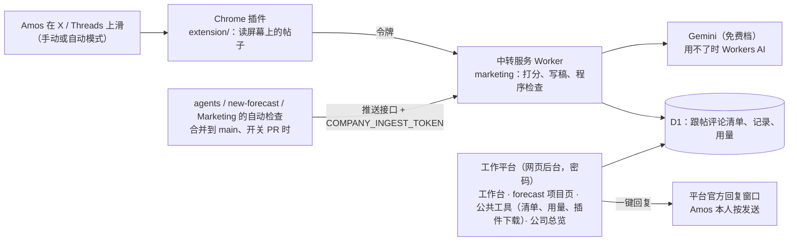

# 项目地图：Marketing
- 用途：**新加入的人或大模型先读这一份**，10 分钟了解项目现在是什么样、代码在哪里、有哪些不能破坏的约定。要查具体的文件、接口、表、变量、历史问题，看《[项目索引](项目索引.md)》。
- 只写**当前状态**；和别的文档不一致时，以本文件和代码为准。
- 版本：v2.1（2026-11-03，两件事。① **新增公共工具「语音生成」**（`src/tts.ts`、`src/tts-page.ts`、`#/tools/tts` → `/api/tts/*`）：粘一段英文 → 选模型 → 看这次要花多少、今天还剩多少 → 生成 → 当场试听 → 下载；默认 melotts（实测“地道”、一句约 0.8 neurons），aura-2-en 可选但界面上写明贵约 129.5 倍（价格表精算 131.8 倍）；记账单独走项目 `tts`，不混进素材生成器那本。**为什么单独拆出来**：“公共工具”的定义是服务所有项目——素材生成器绑死 Practical 那 30 个场景、是项目专用，而“给一段英文生成一段发音”跨项目可复用（forecast 做语音内容、Practical 补一句改一句都用得上），埋在批量生成器里就单独调不出来。公共工具仍是 8 项（下线一个、新增一个）。② **下线两个到期的临时入口**：Amos 填上 `COPILOT_PASSWORD` 后后台能登录了（`/health` 的 `admin` 从 `not_configured` 变 `ok`、`GET /` 200、`POST /api/assets/plan` 401），**发音探针整套删掉**（src/probe.ts、src/probe-page.ts、后台 `#/tools/probe` 和 `/api/probe/*`，实测已跑完）、**素材生成器的受限入口 `/probe-<随机串>/assets/` 也删掉**（正路 `/api/assets/*` 不动）；这些路径现在一律 404、正文和不存在的地址一模一样（`test/retired-routes.test.ts` 守着）；公共工具从 8 项变 7 项）；v2.0（2026-11-03，后台“公共工具”多了两项、一共 8 项：**素材生成器**（Practical 盲听卡的图片 `flux-1-schnell` + 音频 `melotts` 批量生成，先 6 个样片再放量、断点续传、浏览器里打包 zip 下载、生成前先把这次要花多少 neurons 摆出来；`src/assets.ts`、`src/assets-page.ts`、迁移 0009）和**发音探针**（原来那个游离的随机路径页收编进来，`#/tools/probe` → `/api/probe/*`，只在测试版）；工具清单和下线时间统一登记在 agents `工作平台/工具台账.md`（Amos 2026-11-03“工具越来越多 也要注意对工具的管理”））；v1.9（2026-11-02，加了**只在测试版存在**的 Workers AI 探针页（Practical 的发音实测，Amos 打开网址点四个按钮就能跑；src/probe.ts、src/probe-page.ts）：正式版拿不到这个路由，没有鉴权但有随机串地址、每分钟 20 次限流、备用 AI 的每日额度之外再加探针自己 1,500 neurons 的小额度，测完就下线）；v1.8（2026-11-02，页面名称"公司平台"改为"工作平台"（过渡期新旧状态卡 key 和"见…"标记都认）；Webhook：fork 单独成行、投递编号和处理同一个 batch、机器人算外部、缺头直接 401、"最近结束"只显示 7 天）；v1.7（2026-11-02，GitHub Webhook 实时进度 `src/hooks.ts`、迁移 0008、工作台"团队在做什么"、公共工具"Webhook 开关"）；v1.6（2026-11-02，只改文档和索引检查：去掉夹带的公司资料（agents C147）；`scripts/check-project-index.mjs` v3 加"禁放文件"）；v1.5（2026-11-02，公共工具加"每天回帖上限"（按项目，D-2）和"按项目看用量"（表 `usage_by_project`，D-3 不回填）；待办正文在当前页展开（推送带 `body` / `questions`）；一级、二级菜单固定在顶部；在公共工具页刷新时一级菜单的待办数马上显示）；v1.4（2026-11-01，后台改成公司平台——工作台、forecast 项目页、公共工具三层菜单；打勾跨设备带 seen、填数字只存 D1（表 `company_report`）；agents 推周包 `pack`、待办截止时间、交接记录按"项目/岗位"）；v1.3（2026-11-01，本仓库用 `.github/workflows/company.yml` + `scripts/company-report.mjs` 上报自己的【要你决定】PR 和 CI）；v1.2（2026-11-01，后台加第四页"公司"（运营仪表盘）和推送接口；对应代码：副驾驶插件 0.3.5 + 中转服务和网页后台）；v1.1（2026-10-30，后台加"插件下载"）。批次、PR 编号这类进度见 agents `公司平台/技术方案-公司平台.md`
- 维护：研发整合，各角色写自己的部分（C53）。**每次功能迭代，在同一个 PR 里更新本文件和《项目索引》**；`scripts/check-project-index.mjs` 在 CI 里检查（C54）。
- **内部文档**：需求池、技术方案、状态清单、复盘在 agents 仓库（`dollar3651314/agents` 的 `公司平台/`、`公司平台/副驾驶/`，C119），本仓库只放代码和这两份地图、索引。
- 变更历史：v1.0（2026-10-30）首次创建，项目名 Marketing，内部工具；代码从 new-forecast staging `ea4482a` 的 `site/copilot/` 原样搬来（为什么拆出来见 agents `项目版图.md` v1.3）；Worker 和 D1 起初沿用 `quickcome-copilot`，同日改名 `marketing` / `marketing-staging`；正式版绑定 `marketing.quickcome.online`，测试版继续用 workers.dev；仓库公开（只有代码，内部文档在 agents）；旧测试版（quickcome-copilot-staging）的数据搬进正式版，旧测试版转正；10-30 正式版上线，一次性搬数据脚本已删；staging、main 已开分支保护；测试版 marketing-staging 的密钥用的时候再填。决定过程和验收见 agents `公司平台/交接记录/`

## 一图看懂


## 1. 这个项目做什么
营销团队的社媒副驾驶（agents C133、C136）：Amos 刷 X / Threads 时，插件读屏幕上的帖子，AI 打分；分数够的写好回复草稿（过程序检查），存进"跟帖评论清单"；Amos 在网页后台点"一键回复"打开官方回复窗口，自己按发送。现在推广的产品只有 Quick Come（forecast），规则写在 `rules/forecast.ts`；多产品管理在需求池（M-1）。

工作平台（2026-11-01 批 1，agents `公司平台/技术方案-公司平台*.md`、原型 v2）：后台改成三层菜单——**工作台**（默认页：最该做的一件事、全部待办按截止时间排、团队在做什么、项目概况、公司数字、经营会）、**项目页**（现在只有 forecast：下一步做什么、操作指引逐步打勾、数字和决定、本周帖子、焦点战、用到的工具、交接记录）、**公共工具**（跟帖评论清单、每天回帖上限、用量和限额、按项目看用量、插件下载、Webhook 开关）。批 2（2026-11-02）：每天回帖上限每个项目一个数（`settings` 的 `reply_cap:<项目>`，没设退回 `DAILY_REPLY_CAP`；插件 0.3.5 的 `/v1/today` 不带项目按 forecast）；AI 用量按项目多记一份（表 `usage_by_project`，"测试 AI"记 `_platform`，只记不当限额，旧表 `model_usage` / `ai_usage` 和上限逻辑不变）；待办、PR、"在等谁"的正文只认 agents（agents C147），由 agents 的上报脚本带上来（发出前涂掉密钥），点主按钮在当前页展开（只用 textContent，工作台、项目页、公司总览都一样），要到外部平台操作的仍是外链；代码仓库（new-forecast、Marketing）只报 PR 标题和链接，服务端也不存它们推来的正文，外部人提交的单独一条"外部提交，给你看一下"，只给"在 GitHub 打开"；**平台不写 GitHub**（合并等操作在 Claude 窗口做）。实时进度（2026-11-02，方案和决定见 agents）：三个仓库的 GitHub Webhook 推到 `POST /hooks/github`（签名密钥就是 `COMPANY_INGEST_TOKEN` 的值，不新增变量名），写进 0008 的新表，工作台、forecast 页的"团队在做什么"显示每个分支在做什么（岗位按分支名 `claude/<岗位>-<项目>-<主题>` 或 PR 标题【岗位·项目】认，认不出"未标"）、2 小时没动静变灰、24 小时 / 合并 / 删分支进"最近结束"（只显示 7 天内的，库里留 30 天），自己人的 CI 红进工作台顶部提醒；代码仓库只显示分支名、PR 标题、CI，提交说明和正文不显示也不存（agents C147），外部人（含机器人、fork）的标"外部"，fork 来的单独成行、不算进"正在做"。页面名称 2026-11-02 起叫"工作平台"（原"工作平台"）：Marketing 先上、agents 改名后合，过渡期 `src/projects.ts` 的 `NOT_PROJECTS`、`SEE_PLATFORM` 新旧字样都认。三个仓库的 `company.yml` 上报照旧，两条路互不覆盖。打勾存 D1 两台设备共用（带 `seen`，另一处改过回 409）；Amos 填的数字存表 `company_report`，状态卡写"见工作平台"的那一格页面换成平台里的值，第一期不写回 agents。

原来的后台第四页"公司"（现在叫公司总览，右上角"公司"进入，运营仪表盘；技术方案见 agents `公司平台/技术方案-运营仪表盘.md`）：把 agents 的状态卡、交接记录、Amos 待办、项目版图、周报、岗位学习，以及三个仓库的【要你决定】PR 和 CI 放在一页，Amos 只读、可以点"我做了"。推送模型：各仓库的自动检查在合并到 main、开 / 关 PR 时解析好推过来（`POST /api/company/ingest`），Worker 不读 GitHub、没有定时任务（B-6：不要每天兜底）。

## 2. 代码怎么分层
- `extension/`：Chrome 插件（Manifest V3，只要 `sidePanel`、`storage` 权限）。`content.js` 在页面里读帖子、加标记、按指令滑动；`sidepanel.js` 管打分、写稿、存清单、自动模式、设置。
- `src/`：中转服务和网页后台（一个 Worker）。`index.ts` 路由和 `/v1/*`（插件用，令牌）；`queue.ts` 后台接口 `/api/*`（密码登录）；`admin-page.ts` 后台页面（工作平台外框 + 各页）；`company.ts` 公司数据的推送、读取、打勾、填数字接口；`hooks.ts` GitHub Webhook 实时进度（`/hooks/github`、`/api/active`、`/api/hook`）；`projects.ts` 工作平台对照表（填数字校验、"见工作平台"换值）；`ai.ts` / `gemini.ts` / `workers-ai.ts` 调 AI；`checks.ts` 程序检查；`usage.ts` 用量和上限；`assets.ts` + `assets-page.ts` 素材生成器（Practical 专用的批量素材，跟后台登录走）；`tts.ts` + `tts-page.ts` 语音生成（**跨项目**的单段配音，跟后台登录走）。
- `rules/`：给 AI 的打分和写稿规则（每个产品一份）。
- `migrations/`：D1 表结构。

## 3. 环境
| 环境 | 分支 | Worker / D1 | 地址 |
|---|---|---|---|
| 测试版 | `staging` | `marketing-staging` | https://marketing-staging.jeff-zhaifei.workers.dev |
| 正式版 | `main` | `marketing` | https://marketing.quickcome.online （workers.dev 地址先留作备用） |

**只在测试版存在的东西：现在一个都没有了**（2026-11-03）。2026-11-02 到 11-03 之间，测试版上挂过两个**没有鉴权**的临时入口：
Workers AI 发音探针页 `/probe-<随机串>/`（Practical 的发音实测）和它底下素材生成器的受限入口 `/probe-<随机串>/assets/`
（当时 `marketing-staging` 没填 `COPILOT_PASSWORD`、后台登录不了，只好开这个口子）。
Amos 2026-11-03 填上了密码、也跑完了实测，两个口子的存在理由都没有了，**连同后台"公共工具 → 发音探针"整套删掉**：
src/probe.ts、src/probe-page.ts、`src/index.ts` 里那两行、`src/queue.ts` 里 `/api/probe/` 那一段、后台的菜单和模块、`src/assets.ts` 里 `open` 那一套，全部不在了。
**现在 `/probe…` 的任何地址（含 `/assets/` 子路径、任何方法）都是 404，正文就是 `Not found`，和不存在的地址一模一样**——不回"已下线"之类的话，
那等于确认这个路径存在过。`test/retired-routes.test.ts` 守着这一条，以后谁想再加回来会先红。要是 Level 2/3 还要复测 ASR，从提交 `c50d048` 把代码取回来重开一条分支，别在正式路由上留口子。

**两个会花 Workers AI 额度的公共工具，入口和额度口径一样**：都只有后台登录那一条路
（`/api/assets/*`、`/api/tts/*`；没登录 401、`COPILOT_PASSWORD` 没填时 404），都**不替 Amos 另设一层额度**
（Amos 2026-11-03“额度我自己管”）：只看他在“用量和限额”里设的那个每天上限（没设时 8,000，最多 9,500），
生成前先把“这次大概要花多少 neurons、今天还剩多少”摆出来让他决定，真要超上限才 429、不调模型（C117）。
记账分开两本（`usage_by_project` 的项目名 `practical-assets` 和 `tts`），后台“按项目看用量”里看得出哪一笔是谁花的。

**这两个工具的分工**（“公共工具”的定义是**服务所有项目**，这条分工就是按定义来的）：
**素材生成器**（`#/tools/assets`）是 **Practical 专用**——按场景编号和格子记台账、图片和音频一起批量跑、断点续传、浏览器里打包 zip，
只有那 30 个盲听卡场景用得上。**语音生成**（`#/tools/tts`）是**跨项目**的——给一段英文、出一段 MP3、当场试听再下载，
forecast 以后做语音内容、Practical 平时补一句改一句都用得上。默认模型 melotts（Amos 2026-11-03 实测判“地道”，一句约 0.8 neurons）；
aura-2-en 只是可选项，界面上把“贵约 129.5 倍”（实测 103.6 对 0.8；按价格表精算 131.8 倍）直接写在选项旁边，不能只给个模型名让他猜。
给 Practical 当素材时的输出规格（MP3、单声道、≥ 24kHz、≥ 64kbps、时长 1.0～2.5 秒）在页面上提示，工具本身不强制。

开发分支 PR 到 `staging`（合并即部署测试版）；`staging` → `main` 要 Amos 说"合并"（部署正式版）。密钥在 Cloudflare 控制台填，测试版、正式版的值不同。

## 4. 关键流程在哪里
- 打分：插件 `sidepanel.js` → `POST /v1/score` → `src/index.ts` `score()` → `src/ai.ts`。
- 生成 Practical 素材：后台“公共工具 → 素材生成器”粘一份场景 JSON（30 个场景的清单和提示词在 agents，**不进本仓库**，C147）→ 页面先调 `/api/assets/plan` 把这次要花多少 neurons、今天还剩多少显示出来 →“先生成 6 个样片”或“全部生成”，一个文件一次 `/api/assets/gen`（图 `flux-1-schnell`、音频 `melotts`，记账 `chargeNeurons()` 项目 `practical-assets`）→素材存进浏览器 IndexedDB（关掉再打开接着跑，已生成的不重来）、台账写 `asset_gen`（算真实出图成功率）→ “打包下载 zip”在浏览器里压包（含 `scenes.json`、`meta.txt`）。**服务端不存任何素材字节。**
- 写稿和存清单：`saveToList()`（`sidepanel.js`）→ `/v1/draft`（程序检查 `src/checks.ts`）→ `/v1/queue` → `src/queue.ts` `saveToQueue()`。
- 自动模式：`sidepanel.js` `autoLoop()` 一步一步让 `content.js` 滑一屏；切分页停、读不到新帖暂停、存满 N 条停、到时间停。
- 后台：`src/admin-page.ts`（页面）+ `src/queue.ts` `adminApi()`（接口）。
- 本仓库自己的上报：推送到 main、PR 开 / 关 / 重开 / 改标题、main 的 CI（ci）跑完 → `.github/workflows/company.yml` → `scripts/company-report.mjs`（读本仓库 PR 和 ci.yml 的运行，source = `marketing`）→ `POST /api/company/ingest`；没填 Actions Secret `COMPANY_INGEST_TOKEN` 时打印"跳过"。
- 公司页：各仓库自动检查 → `POST /api/company/ingest`（`src/company.ts` `companyIngest()`，在后台密码判断之前处理）→ 表 `company_snapshot`；页面 `go('company')` → `GET /api/company`；"我做了" → `POST /api/company/done` → 表 `company_done`。
- 工作平台外框：`src/admin-page.ts` 第一段脚本 `route()` 按地址锚点 `#/<页>/<模块>` 切页、滚到模块；工作台、项目页由第三段脚本 `platformOpen()` 读 `GET /api/company` + `GET /api/queue` 渲染，停在这两页时每 30 秒重读；打勾 `POST /api/company/done`（带 `seen`），填数字 `POST /api/company/report` → 表 `company_report`。待办的截止时间由 agents 的解析脚本算好推来（`due`），【只看】PR 按开 PR 时间 + 48 小时、CI 变红排第一由页面算。
- 团队在做什么：GitHub → `POST /hooks/github`（`src/hooks.ts` `githubHook()`，在后台密码判断之前处理：缺头 401 → 512 KB → 验签 → 开关 → 解析 → 事件 / 仓库白名单 → 限流 → 投递编号去重 → 投递编号和处理同一个 batch）→ 表 `active_item`、`active_log`、`gh_delivery`；页面第三段脚本 `refresh()` 多读 `GET /api/active`，`renderLive()` 渲染工作台和 forecast 页；开关在公共工具 `loadHook()` → `POST /api/hook`。
- 插件下载：部署时 `scripts/build-ext-zip.mjs` 把 `extension/` 打成 zip 放进服务；后台"插件下载"页登录后下载，所以后台给的插件和线上服务一定是同一个提交。

## 5. 不能破坏的约定
1. 插件只读屏幕上已显示的帖子、只在 Amos 打开开关时滑动；不点赞、不关注、不私信、不点开帖子、不代按发送；不做规避平台检测的处理（C133、C136）。
2. 自动模式的边界按 agents《营销团队手册》A8 第 7 条：每次最多 30 分钟（只能往下调）或存满 N 条；切分页、关分页或侧边栏就停；页面出现登录、验证、太频繁、出错立刻停。
3. 草稿要过程序检查才给 Amos 看：不能说的话（含下注说法）、提产品、链接、政治、字数、数字要有出处、原帖没有的结论（R-1、R-2）。
4. `COPILOT_TOKEN`、`GEMINI_API_KEY`、`COPILOT_PASSWORD` 没填时对应接口一律 404（默认关着）；密钥不进仓库、不经过 AI。
5. Workers AI 每天上限最多 9,500（免费额度 10,000），不产生费用（C117）。
6. **不再开没有鉴权的 AI 接口**：`/probe…` 那一套（发音探针、素材生成器的受限入口）2026-11-03 已经整套下线，现在一律 404 且正文和不存在的地址一样（`test/retired-routes.test.ts` 守着）。以后要临时开口子，先过 Amos，并在 agents `工作平台/工具台账.md` 里登记下线时间和下线办法。
7. 清单记录不自动删，只由 Amos 在后台删（D-4 选 B）。
8. 每个窗口的插件设置各自生效（0.3.3）；界面上的提示和实际行为一致（C140）。
9. 公司页（2026-11-01）：`COMPANY_INGEST_TOKEN` 没填时推送接口 404、页面显示"还没开通"；推送只依赖这个令牌（不要会话），只写公司的三张表；某块解析失败时保留上次成功的内容、页面显示"解析失败：原因"；**公司页脚本单独一个 `<script>`、整段 try/catch、只在打开这页时执行，旧三页的代码不动**；内容一律 `textContent` 插入；不加定时任务。
10. 工作平台（批 1）：**清单、用量和限额、插件下载三块的脚本和接口不动，只换外框**（`scripts/e2e-queue.mjs` 基线保持全绿）；工作台、项目页的脚本单独一段、整段 try/catch；填数字前后端同一套校验（`src/projects.ts` `normReport()` 和页面里的同名函数，改一边要改另一边，C108）；地址锚点（`#/work/todo` 等）刷新不丢位置；`/queue` 直接进清单（插件"打开跟帖评论清单"按钮开 `/`，落在工作台，顶部有清单入口，风险 R-2）。
11. 批 2：正文只收 agents 推来的（代码仓库推来的用 `src/company.ts` `CODE_SCHEMA`，正文一律不存、收 `external`）；待办正文字段 `body`（≤ 4000 字，超长截断并标 `body_cut`，不报 400）、`body_cut`、`questions`（≤ 20 条，每格 ≤ 500 字）只在 `prs.items`、`todo.items`、`status.waiting` 上收；页面只用 textContent 显示；用量按项目记失败只打日志，不影响打分和写稿；两层菜单在 `#bars` 里一起 sticky，模块的 `scroll-margin-top` 跟着菜单高度（`--bars-h`）。
12. **格式即接口**：agents 的状态卡、交接记录、Amos 待办、周报的标题和列头由 agents 的解析脚本读，推过来的字段白名单在 `src/company.ts` 的 `SCHEMA`；改字段要两边同一批改。`scripts/company-report.mjs` 在 new-forecast 有一份内容相同的，改一边要同步另一边（对拍用例在 `test/company.test.ts`）。
13. Webhook：缺签名头或事件头直接 401（不读请求体、不碰 D1）；**先验签再解析**，签名不对的请求只写 `settings` 的 `hook:bad_sig_at`（每分钟最多一次）、不读开关、不碰别的表；请求体上限 512 KB；不新增变量名（签名密钥 = 去首尾空格的 `COMPANY_INGEST_TOKEN`，没填 404）；开关关着时验签通过回 200、一条都不写；`active_item` 只在事件时间不早于库里的时候覆盖（乱序不倒退，CI 另按 `ci_at` 比）；投递编号和这次的写库放在同一个 batch（失败整批回滚、回 503，重送照常处理）；fork 来的 PR / CI 单独成行（键 `<fork 所有者>:<分支>`），不碰内部同名分支；代码仓库（new-forecast、Marketing）和外部人的提交说明、所有 PR 正文不存（C147）；变灰、24 小时进最近结束（显示 7 天、库里留 30 天）在读的时候算，不加定时任务；分支名短码和 agents `经营/读取路线表/主会话.md` 派工单模板一致，改一边要改另一边。

## 6. 常用命令
```
npm ci
npm run typecheck
npm test                       # 单元测试（D1 用本地 SQLite，AI 用替身）
node scripts/e2e-ext.mjs       # 插件侧边栏浏览器测试（要先 npx playwright install chromium）
node scripts/e2e-admin.mjs     # 网页后台浏览器测试（本地 wrangler dev + 本地 D1；--shots <目录> 另存公司页截图）
node scripts/e2e-platform.mjs  # 工作平台批 1 验收（浏览器级：工作台、项目页、菜单、打勾跨设备、填数字、周包）
node scripts/e2e-tools.mjs     # 工作平台批 2 验收（公共工具：每天回帖上限、按项目看用量、待办正文展开、菜单固定、刷新后菜单待办数）
node scripts/e2e-live.mjs      # Webhook 实时进度验收（团队在做什么、CI 红提醒、签名不对、有延迟、Webhook 开关）
node scripts/e2e-queue.mjs     # 跟帖评论清单基线（一键回复、我回了、跳过、删除、筛选、"今天"计数；工作平台每个 PR 都要全绿）
node scripts/check-project-index.mjs
npm run dry-run                # 检查 wrangler 配置能不能打包
```
打包插件：部署后在后台"插件下载"页下载；本地用 `npm run build:ext`（生成 src/generated 文件夹里的 extension.ts，不进仓库）。

## 7. 排查从哪里开始
- 插件没反应：侧边栏"日志"页（可以下载全部）；X / Threads 页面要在装插件之后刷新。
- "AI 暂时都用不了"：提示里写了每个模型的原因；后台"用量和限额"页看次数、状态和重置时间。
- 后台登不进：同一 IP 15 分钟错 5 次会锁 15 分钟，提示统一是"登录失败，请稍后再试"。
- 健康检查：`/health` 的 `copilot`、`admin`、`company` 是 `ok` 还是 `not_configured`。
- 公司页"做得怎么样"里 Marketing 那行不对：看本仓库 Actions 里 `company` 的运行日志（`node scripts/company-report.mjs --dry-run` 可在本机看要发什么）。它只在推送 main 和 PR 事件时跑，合并后 CI 还在跑时报的是"运行中"，下一次事件才更新。
- 公司页某块是灰的：数据超过 7 天没推过来，看对应仓库的自动检查有没有跑、有没有红叉；某块"解析失败"：agents 的文件格式改了，按原因改文件或解析脚本。

## 8. 常见改动的检查清单
- 改插件：`extension/manifest.json` 版本加一（后台下载的文件名用这个版本号，不加就分不出新旧）；跑 `node scripts/e2e-ext.mjs`；按 agents《副驾驶状态清单》走一遍并截图（C127、C141）。
- 改表：新加 `migrations/000N_*.sql`，不改旧文件；索引第 4 节同步。
- 改给 AI 的规则：`rules/*.ts` 和 `src/checks.ts` 一起看；规则来源是 agents 简报和团队手册。
- 改自动模式的边界：先改 agents《营销团队手册》A8（规则文件，要 Amos 说"合并"）。

## 9. 冷启动问题清单
- 新环境要 Amos 在 Cloudflare 填三个密钥（公司页另要 `COMPANY_INGEST_TOKEN`，同一个值也填进三个仓库的 Actions Secrets；没填时公司页"还没开通"），GitHub 填 `CLOUDFLARE_API_TOKEN`、`CLOUDFLARE_ACCOUNT_ID`；没填时部署打印"跳过"。
- 第一次部署会按名字查 D1，没有就建，再执行全部迁移。
