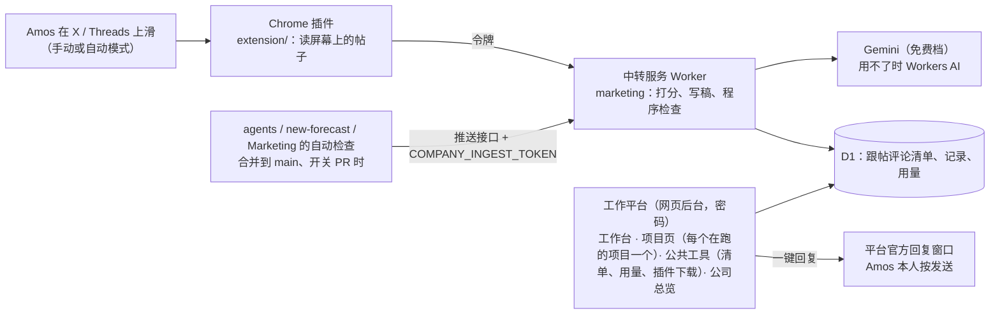

# 项目地图：Marketing
- 用途：**新加入的人或大模型先读这一份**，10 分钟了解项目现在是什么样、代码在哪里、有哪些不能破坏的约定。要查具体的文件、接口、表、变量、历史问题，看《[项目索引](项目索引.md)》。
- 只写**当前状态**；和别的文档不一致时，以本文件和代码为准。
- 版本：v3.0（2026-11-04，**工作平台界面改版·批 A**（原型 prototype-work.html，Amos 11/4"好很多了，改吧"）：全站设计变量（新增 `--surface-2 --ink-2 --teal-ink --hero-bg --hero-line --gray-soft`、字号 5 级 `--fs-*`、间距 `--s1`～`--s7`，明暗两套）；外框两层菜单固定、手机上各一行横滑、右边缘渐隐（一级菜单也加了 `.more`）；去掉 `.page::after{height:60vh}`，`subSpy()` 改成"快到底时判定线下移"；工作台 7 个模块改成"标题行 → 一句话结论 `.lead` → 主内容 → 折叠的 `details.more`"，全部待办**按时间段分组**（已超时 / 24 小时内到期 / 之后到期 / 没定截止时间，最后一组默认收起）+ 按项目筛选，项目概况改卡片 + 进度条、公司数字改数字块；第一次读取时显示占位骨架 `#boot`，读取失败保留上次内容并写"下面是 HH:MM 读到的" + "再读一次"）；v2.9（2026-11-04，**二级菜单跟着滚动·第 2 轮**：并排的几块（顶端差 ≤4px，例如 1280 宽 forecast 的 f-pack / f-match）当前选中的在这一排里就不变、从别处滑进来选菜单里靠前的；选中项变了时把它滚进横向子菜单的可见范围（只改 `.sub .in` 的 scrollLeft）；公共工具清单、用量、回帖上限异步画完后也重算一次）；v2.8（2026-11-04 夜，**英语练习的提示词改到 v4：先把 C-2 这条"纯语音做不到"的场景换掉**。Amos 当天用 v3 和 Gemini Live 真聊了一轮，复盘出 6 个问题，最严重的是**我们自己的设计错**：C-2 原来是「请同事帮我看一段代码」，实录里 AI 直接说 `I cannot see your screen right now. Can you share your screen or turn on your camera?`，**对话死在那儿**。改动：① **C-2 整条重写**成「请同事帮我顶一下明天的一个会」（Raj 还是 Raj，☆ 不变），另外 7 条逐条审过"只有声音办不办得成"——7 条的那件小事本身都是口头能办成的（站会汇报、两个方案选哪个、讲清楚卡在哪、带新人、交接、争论可维护性、告诉对方要往后排），只有 AI 临时起意要看东西的风险，由新加的兜底规则封死。② **8 条的「规则」整段换新**（从 9 行变 19 行，含帮扶五级）：只用日常办公常用词、超纲词主动解释（它自己冒出 `specific`，他当场问这词什么意思）；**每轮最多问一个问题** + 「多让我说」`tell me more about that` / `why is that?`（他全场只说了 11 句、平均 6～8 个词，主动权全在 AI 手里）；卡住 5 秒不再换个简单问题，改成**当场点名**`try saying: Let me think for a second`（屏幕上摆着拖时间的话他也用不上，还是说 "Um. Um. I don't know how to say."）；**帮扶五级台阶**（见下面第 ⑤ 条），给整句时**限 8 个词、不带从句**（上一轮给的 `I need help with some code that you know well.` 带从句，他念成了两句）；最后一条兜底**「不要让我看屏幕、看代码、看文件、发链接——我们只有声音」**。③ **`done` 收尾整段换新**：从「我哪 3 句最不地道」改成**逐句列全 + 引用我的原话必须一字不差**（上一轮只给 3 句，还把 "Yes, it's urgent for me." 引述成 "Is it urgent for me."，漏了好几处），并从两问变**三问**（多报三个数，见第 ⑤ 条）。④ 页面顶部「卡住了怎么办」从三行变**四行**：`help` 那行改成「它**先用中文告诉你想说什么**，让你自己翻；真不行才给整句」，第三行「卡住时它会**直接告诉你念哪一句**，照念就行」，末尾加一行「**这一轮结束前，靠提示说出来的句子它会再考你一次**——说得出来才算学会」。⑤ **帮扶分级 + 回收**（同一版里加的，Amos 定了产品使命「**真能教会，就是咱们这个产品的使命**」，并**取消"日"的概念**，他一天连跑很多轮当试验品）：原来那条「说 `help` 就给你 2 句可以直接念出来的英文」**就是"照着屏幕念"——念十句不等于会说一句，给完就算完等于没教**。改成**五级台阶、只给刚好够的那一级、不许跳级**（① 等 3 秒 → ② 用中文说出我想表达的意思让我自己翻 → ③ 只给句首 → ④ 只给 2～3 个关键词 → ⑤ 实在不行才给一整句让我念，≤ 8 个词、不带从句），`help` **从第 2 级起**；**回收是最重要的一条**：靠句首 / 关键词 / 整句才说出来的，**这一轮结束前换个说法、不给任何提示再考一次**，说得出来才算学会；**难度跟着表现走**（连 3 句不用提示就少给帮助，连 2 句靠整句就缩小话题）。`done` 收尾因此从两问变三问，多**报三个数**（自己造的 / 靠提示的 / 回收时独立说对的）。依据：【证实】回忆比重读有效，但只在成功率中高 + 有反馈时才成立；【线索】被逼着产出能推动语法加工（Swain 输出假说，学界有争议），硬的是那个观察——沉浸式学生听得懂、一开口还是非母语，所以第 5 级必须从"终点"变成"台阶"。**这一版没动、留给下一版定**：页面上「一天一条 · 10 分钟封顶」和第 4 步那句还在，但 Amos 已经说**取消"日"的概念**（他一天连跑很多轮当试验品），这两处文案和他的新口径对不上，本轮改动清单里没有这一项，所以没改。「开始之前」那段（5 个语块 + 3 句拖时间的话）、角色设定（C-2 除外）、「今天只聊一件事」（C-2 除外）、`slow down` 那条**一个字没动**，顺序、☆ 照旧。**两边仍然逐字节一致**：agents《项目/Practical/测试场景-提示词-上.md》《-下.md》8 个代码块 和 `src/english-page.ts` 8 个 `<pre>`，这一轮是用同一段脚本同时改两个文件、再用 sha256 逐条核过的（8 条合计 10,688 字）。**纯静态照旧**：不调接口、不加迁移、不新增费用（C117）；测试从 353 条变 355 条（新增「纯语音可行性：没有一条要求看屏幕/看代码/看文件，8 条都带那句封死的规则」和「C-2 是请同事帮我顶一个会，不是帮我看代码」两条），改动过的断言只是跟着新正文走、**没有放宽**（三处故意改坏都确认会红），**没有跳过或删除任何一条**（底线 6））；v2.7（2026-11-04，**二级菜单跟着滚动选中**：以前只有点子菜单时才改 `nav.sub a[aria-current]`，用户自己滑页面时选中样式不动；现在 `src/admin-page.ts` 的 `subSpy()` 在滚动时（passive 监听 + requestAnimationFrame，每帧最多算一次）选"顶端已过顶栏底边 +16px"的最后一个模块、滑到底选最后一个、都没过选第一个；只改 `aria-current`，不改地址；工作台、项目页、公共工具都有，公司总览没有二级菜单。`e2e-platform`「子菜单跟着滚动」段、`e2e-tools` I 段守着）；v2.6（2026-11-04 晚，**英语练习的提示词改到 v3：解决「紧张 → 接不上话」**（Amos 第 2 天实测原话：「整体感觉比昨天还要好…但是我还是遇到了新问题：虽然是和机器聊，但还是会紧张，紧张就会接不上话，在页面上或者感受到跟不上的时候，是不是可以给一些适当提示会好一些，引导我将对话继续推进下去」）。**要的是「卡住时有话可说」，不是「别卡住」**——母语者接不上时也靠几句拖时间的话争取时间。两处改动：① **8 条提示词的「规则」各加 4 条**（卡住超过 5 秒它主动把问题换成 yes/no 或二选一、说 `help` 给 2 句能直接念出来的英文（英文＋中文）、它每次用一个具体小问题收尾不抛开放式大问题、明说允许停顿和重说且不安慰不夸），**「开始之前」那句改成 5 个语块 + 3 句「拖时间」的话**（Let me think for a second… / That's a good question… / How do I put this…）；角色设定、「今天只聊一件事」、`slow down` 那条、`done` 收尾的两问**一个字没动**，顺序、标题、☆ 照旧。② **页面顶部多一个不折叠的「卡住了怎么办」小块**（`.en-stuck`，和提示词正文分开、不塞进代码块）：说 `help` / 说 `slow down`、`say that again` / 说 `Let me think for a second…` 三行，手机 390 宽一眼看得到（实测在首屏，复制按钮也在首屏，不横滑）。**两边必须逐字节一致**：agents《项目/Practical/测试场景-提示词-上.md》《-下.md》8 个代码块 和 `src/english-page.ts` 8 个 `<pre>`（agents 那边把原单页拆成了入口页 + 提示词上/下，因为 v3 正文撑破它仓库的 7,000 字页面上限，**正文一个字没动**），改的时候用同一段脚本同时改两个文件；`test/english.test.ts` 那条「8 条共用的三段一字不差」就是守这件事的。**纯静态照旧**：不调接口、不加迁移、不新增费用（C117）；测试从 352 条变 353 条（新增「卡住了怎么办」不折叠那一条），**没有跳过、删除或放宽任何一条**（底线 6））；v2.5（2026-11-03 晚，**工作台加「英语练习」模块**（Amos 睡前：「把提示词放到工作台上吧…明天一早我去工作台找提示词，然后用 Gemini 陪我练习」）：工作台二级菜单加**第 7 项**「英语练习」（`#/work/english`、模块 `#w-english`，排在「经营会」后面），把 agents 仓库《项目/Practical/测试场景-提示词-上.md》《-下.md》（v3 前是单页《测试场景-粘给Gemini.md》）里 8 条提示词（C-1～C-6、N-1、N-2，带 ☆ 难度）**原文照抄**印上去，**每条一个「复制」按钮**（他用手机，长按选一大段文字很痛苦）：先 `navigator.clipboard.writeText`，非 https 或浏览器不给权限时退回隐藏 `textarea` + `document.execCommand('copy')`，成功变「已复制 ✓」2 秒后变回；正文默认折叠 `<details>`，**按钮在折叠外面，不展开就能点到**。**为什么放工作台不放公共工具**：公共工具菜单 8 项已满（T-4，第 9 项撑破手机菜单，不许加），工作台原来只有 6 项、还有空位，而且工作台是他打开就落地的默认页。**手机 390 宽**：工作台菜单按治公共工具的同一个办法折成两行（7 项全在屏幕里、不用横滑，两层菜单占屏高 22.3% ≤ 25%）。**纯静态**：不调接口、不读数据库、不加迁移、不新增费用（C117），新增 16 条单元测试 + `e2e-platform` 一段（390 / 1280 两种宽度，连剪贴板里拿到的是不是那一整条原文都核）；现有 336 条测试一条没动（底线 6））；v2.4（2026-11-03，**用量监控那个数不能再误导人**：后台写「今天已用 115 / 9500，还剩 9385」，点生成却被 Cloudflare 拒了（`4006: you have used up your daily free allocation of 10,000 neurons…`），Amos 被这个数误导了两次。**根因【证实】**：`marketing` 和 `marketing-staging` 是**两个不同的 D1**、各记各的账，而 Cloudflare 的 **10,000 neurons/天是按整个账号算的**、两个环境共用（那天的 109 个素材是在测试版生成的，所以正式版账上只有 115）。改了三处：① 「还剩多少」里 Workers AI 那一行当面说清**这是本环境自己记的账、不是 Cloudflare 的真实剩余**，「已用」只是**下限**、「还剩」只是**最多还有这么多**，**不把两个环境加起来冒充真实值**（底线 3）；② Cloudflare 自己说「额度用完了」时记一行（新表 `account_limit`，迁移 `0011`，只 CREATE），后台置顶一句红字写明几点清零（UTC 0 点＝台湾早上 8 点，**在代码里算**），**到下一个 UTC 日自动消失**；③ 那句英文翻成人话：**按文案认**账号级额度用尽（4006 不在官方错误表里，表里是 3036；3036 / 429 也认），中文说清「不是这个工具的问题 / 明早 8 点清零、到点点同一个按钮接着跑 / 要现在继续只能升级 Workers Paid，那要花钱、Amos 自己决定」，英文原话附在后面括号里，**不给链接也不劝他升级**（C117）。**没做**：不去接 Cloudflare 的 GraphQL 分析接口（要 Amos 的 API 令牌）——所以真实剩余我们仍然查不到，这一点在页面上也写明了）；v2.3（2026-11-03，**用量监控**（Amos「我没有办法生成素材，总提示我停下了…最好提炼出一个 token 监控的模块，可以看到剩余和分别用到了哪里」）：**没有新开一个页**——原来的公共工具「用量和限额」（`#/tools/usage`）本来就答得出「还剩多少」，所以在它里面补成三块：「还剩多少」（两本账分开：Workers AI 按 neurons、Gemini 按次数，**不加在一起**，各自写明几点清零）、原来的「每个模型的用量和上限」、「分别用到了哪里」（按**用途**拆：素材生成器·图片 / 素材生成器·音频 / 语音生成 / 跟帖草稿 / 跟帖评分 / 平台自己）。新表 `usage_by_purpose`（迁移 `0010`，只 CREATE）：按项目记的那本分不出素材生成器里哪一笔是出图、哪一笔是配音，所以另记一本；`asset_gen` 虽然分得出格子但**没有按天的列**，算不出「今天这一项用了多少」。**这一版以前的用量没有用途，不回填也不估算**，差额单独列成「没按用途记下来的」、次数写「没记录」（底线 3）。公共工具仍是 8 项，没有新增费用）；v2.2（2026-11-03，**把 main 上 #24「工作台：项目页动态化 + 待办按项目分组」合回测试版**（这个 PR 当初直接 squash 进 main、没有回流）：**项目页不再写死 forecast**：一级菜单和项目页按 agents 推来的 `projects` 块（项目版图"产品"表）动态出，块没推上来退回兜底 `['forecast']`；工作台"全部待办"按项目分组、逾期置顶。素材生成器、语音生成两个公共工具照旧在「公共工具」里，没有受影响）；v2.1（2026-11-03，两件事。① **新增公共工具「语音生成」**（`src/tts.ts`、`src/tts-page.ts`、`#/tools/tts` → `/api/tts/*`）：粘一段英文 → 选模型 → 看这次要花多少、今天还剩多少 → 生成 → 当场试听 → 下载；默认 melotts（实测“地道”、一句约 0.8 neurons），aura-2-en 可选但界面上写明贵约 129.5 倍（价格表精算 131.8 倍）；记账单独走项目 `tts`，不混进素材生成器那本。**为什么单独拆出来**：“公共工具”的定义是服务所有项目——素材生成器绑死 Practical 那 30 个场景、是项目专用，而“给一段英文生成一段发音”跨项目可复用（forecast 做语音内容、Practical 补一句改一句都用得上），埋在批量生成器里就单独调不出来。公共工具仍是 8 项（下线一个、新增一个）。② **下线两个到期的临时入口**：Amos 填上 `COPILOT_PASSWORD` 后后台能登录了（`/health` 的 `admin` 从 `not_configured` 变 `ok`、`GET /` 200、`POST /api/assets/plan` 401），**发音探针整套删掉**（src/probe.ts、src/probe-page.ts、后台 `#/tools/probe` 和 `/api/probe/*`，实测已跑完）、**素材生成器的受限入口 `/probe-<随机串>/assets/` 也删掉**（正路 `/api/assets/*` 不动）；这些路径现在一律 404、正文和不存在的地址一模一样（`test/retired-routes.test.ts` 守着）；公共工具从 8 项变 7 项）；v2.0（2026-11-03，后台“公共工具”多了两项、一共 8 项：**素材生成器**（Practical 盲听卡的图片 `flux-1-schnell` + 音频 `melotts` 批量生成，先 6 个样片再放量、断点续传、浏览器里打包 zip 下载、生成前先把这次要花多少 neurons 摆出来；`src/assets.ts`、`src/assets-page.ts`、迁移 0009）和**发音探针**（原来那个游离的随机路径页收编进来，`#/tools/probe` → `/api/probe/*`，只在测试版）；工具清单和下线时间统一登记在 agents `工作平台/工具台账.md`（Amos 2026-11-03“工具越来越多 也要注意对工具的管理”））；v1.9（2026-11-02，加了**只在测试版存在**的 Workers AI 探针页（Practical 的发音实测，Amos 打开网址点四个按钮就能跑；src/probe.ts、src/probe-page.ts）：正式版拿不到这个路由，没有鉴权但有随机串地址、每分钟 20 次限流、备用 AI 的每日额度之外再加探针自己 1,500 neurons 的小额度，测完就下线）；v1.8（2026-11-02，页面名称"公司平台"改为"工作平台"（过渡期新旧状态卡 key 和"见…"标记都认）；Webhook：fork 单独成行、投递编号和处理同一个 batch、机器人算外部、缺头直接 401、"最近结束"只显示 7 天）；v1.7（2026-11-02，GitHub Webhook 实时进度 `src/hooks.ts`、迁移 0008、工作台"团队在做什么"、公共工具"Webhook 开关"）；v1.6（2026-11-02，只改文档和索引检查：去掉夹带的公司资料（agents C147）；`scripts/check-project-index.mjs` v3 加"禁放文件"）；v1.5（2026-11-02，公共工具加"每天回帖上限"（按项目，D-2）和"按项目看用量"（表 `usage_by_project`，D-3 不回填）；待办正文在当前页展开（推送带 `body` / `questions`）；一级、二级菜单固定在顶部；在公共工具页刷新时一级菜单的待办数马上显示）；v1.4（2026-11-01，后台改成公司平台——工作台、forecast 项目页、公共工具三层菜单；打勾跨设备带 seen、填数字只存 D1（表 `company_report`）；agents 推周包 `pack`、待办截止时间、交接记录按"项目/岗位"）；v1.3（2026-11-01，本仓库用 `.github/workflows/company.yml` + `scripts/company-report.mjs` 上报自己的【要你决定】PR 和 CI）；v1.2（2026-11-01，后台加第四页"公司"（运营仪表盘）和推送接口；对应代码：副驾驶插件 0.3.5 + 中转服务和网页后台）；v1.1（2026-10-30，后台加"插件下载"）。批次、PR 编号这类进度见 agents `公司平台/技术方案-公司平台.md`
- 维护：研发整合，各角色写自己的部分（C53）。**每次功能迭代，在同一个 PR 里更新本文件和《项目索引》**；`scripts/check-project-index.mjs` 在 CI 里检查（C54）。
- **内部文档**：需求池、技术方案、状态清单、复盘在 agents 仓库（`dollar3651314/agents` 的 `公司平台/`、`公司平台/副驾驶/`，C119），本仓库只放代码和这两份地图、索引。
- 变更历史：v1.0（2026-10-30）首次创建，项目名 Marketing，内部工具；代码从 new-forecast staging `ea4482a` 的 `site/copilot/` 原样搬来（为什么拆出来见 agents `项目版图.md` v1.3）；Worker 和 D1 起初沿用 `quickcome-copilot`，同日改名 `marketing` / `marketing-staging`；正式版绑定 `marketing.quickcome.online`，测试版继续用 workers.dev；仓库公开（只有代码，内部文档在 agents）；旧测试版（quickcome-copilot-staging）的数据搬进正式版，旧测试版转正；10-30 正式版上线，一次性搬数据脚本已删；staging、main 已开分支保护；测试版 marketing-staging 的密钥用的时候再填。决定过程和验收见 agents `公司平台/交接记录/`

## 一图看懂


## 1. 这个项目做什么
营销团队的社媒副驾驶（agents C133、C136）：Amos 刷 X / Threads 时，插件读屏幕上的帖子，AI 打分；分数够的写好回复草稿（过程序检查），存进"跟帖评论清单"；Amos 在网页后台点"一键回复"打开官方回复窗口，自己按发送。现在推广的产品只有 Quick Come（forecast），规则写在 `rules/forecast.ts`；多产品管理在需求池（M-1）。

工作平台（2026-11-01 批 1，agents `公司平台/技术方案-公司平台*.md`、原型 v2）：后台改成三层菜单——**工作台**（默认页：最该做的一件事、全部待办**按时间段分组 + 按项目筛选**（批 A，2026-11-04 起；原来按项目折叠）、团队在做什么、项目概况、公司数字、经营会、英语练习（提示词 v4，顶部带「卡住了怎么办」四行））、**项目页**（**每个在跑的项目一个**：下一步做什么、操作指引逐步打勾、数字和决定、本周帖子、焦点战、用到的工具、交接记录）、**公共工具**（跟帖评论清单、每天回帖上限、用量和限额（里面含**用量监控**：还剩多少 / 每个模型的用量和上限 / 分别用到了哪里）、按项目看用量、插件下载、Webhook 开关、素材生成器、语音生成）。批 2（2026-11-02）：每天回帖上限每个项目一个数（`settings` 的 `reply_cap:<项目>`，没设退回 `DAILY_REPLY_CAP`；插件 0.3.5 的 `/v1/today` 不带项目按 forecast）；AI 用量按项目多记一份（表 `usage_by_project`，"测试 AI"记 `_platform`，只记不当限额，旧表 `model_usage` / `ai_usage` 和上限逻辑不变）；待办、PR、"在等谁"的正文只认 agents（agents C147），由 agents 的上报脚本带上来（发出前涂掉密钥），点主按钮在当前页展开（只用 textContent，工作台、项目页、公司总览都一样），要到外部平台操作的仍是外链；代码仓库（new-forecast、Marketing）只报 PR 标题和链接，服务端也不存它们推来的正文，外部人提交的单独一条"外部提交，给你看一下"，只给"在 GitHub 打开"；**平台不写 GitHub**（合并等操作在 Claude 窗口做）。实时进度（2026-11-02，方案和决定见 agents）：三个仓库的 GitHub Webhook 推到 `POST /hooks/github`（签名密钥就是 `COMPANY_INGEST_TOKEN` 的值，不新增变量名），写进 0008 的新表，工作台、forecast 页的"团队在做什么"显示每个分支在做什么（岗位按分支名 `claude/<岗位>-<项目>-<主题>` 或 PR 标题【岗位·项目】认，认不出"未标"）、2 小时没动静变灰、24 小时 / 合并 / 删分支进"最近结束"（只显示 7 天内的，库里留 30 天），自己人的 CI 红进工作台顶部提醒；代码仓库只显示分支名、PR 标题、CI，提交说明和正文不显示也不存（agents C147），外部人（含机器人、fork）的标"外部"，fork 来的单独成行、不算进"正在做"。页面名称 2026-11-02 起叫"工作平台"（原"工作平台"）：Marketing 先上、agents 改名后合，过渡期 `src/projects.ts` 的 `NOT_PROJECTS`、`SEE_PLATFORM` 新旧字样都认。三个仓库的 `company.yml` 上报照旧，两条路互不覆盖。打勾存 D1 两台设备共用（带 `seen`，另一处改过回 409）；Amos 填的数字存表 `company_report`，状态卡写"见工作平台"的那一格页面换成平台里的值，第一期不写回 agents。

原来的后台第四页"公司"（现在叫公司总览，右上角"公司"进入，运营仪表盘；技术方案见 agents `公司平台/技术方案-运营仪表盘.md`）：把 agents 的状态卡、交接记录、Amos 待办、项目版图、周报、岗位学习，以及三个仓库的【要你决定】PR 和 CI 放在一页，Amos 只读、可以点"我做了"。推送模型：各仓库的自动检查在合并到 main、开 / 关 PR 时解析好推过来（`POST /api/company/ingest`），Worker 不读 GitHub、没有定时任务（B-6：不要每天兜底）。

## 2. 代码怎么分层
- `extension/`：Chrome 插件（Manifest V3，只要 `sidePanel`、`storage` 权限）。`content.js` 在页面里读帖子、加标记、按指令滑动；`sidepanel.js` 管打分、写稿、存清单、自动模式、设置。
- `src/`：中转服务和网页后台（一个 Worker）。`index.ts` 路由和 `/v1/*`（插件用，令牌）；`queue.ts` 后台接口 `/api/*`（密码登录）；`admin-page.ts` 后台页面（工作平台外框 + 各页）；`company.ts` 公司数据的推送、读取、打勾、填数字接口；`hooks.ts` GitHub Webhook 实时进度（`/hooks/github`、`/api/active`、`/api/hook`）；`projects.ts` 工作平台对照表（填数字校验、"见工作平台"换值）；`ai.ts` / `gemini.ts` / `workers-ai.ts` 调 AI；`checks.ts` 程序检查；`usage.ts` 用量和上限；`assets.ts` + `assets-page.ts` 素材生成器（Practical 专用的批量素材，跟后台登录走）；`tts.ts` + `tts-page.ts` 语音生成（**跨项目**的单段配音，跟后台登录走）。
- `rules/`：给 AI 的打分和写稿规则（每个产品一份）。
- `migrations/`：D1 表结构。

## 3. 环境
| 环境 | 分支 | Worker / D1 | 地址 |
|---|---|---|---|
| 测试版 | `staging` | `marketing-staging` | https://marketing-staging.jeff-zhaifei.workers.dev |
| 正式版 | `main` | `marketing` | https://marketing.quickcome.online （workers.dev 地址先留作备用） |

**只在测试版存在的东西：现在一个都没有了**（2026-11-03）。2026-11-02 到 11-03 之间，测试版上挂过两个**没有鉴权**的临时入口：
Workers AI 发音探针页 `/probe-<随机串>/`（Practical 的发音实测）和它底下素材生成器的受限入口 `/probe-<随机串>/assets/`
（当时 `marketing-staging` 没填 `COPILOT_PASSWORD`、后台登录不了，只好开这个口子）。
Amos 2026-11-03 填上了密码、也跑完了实测，两个口子的存在理由都没有了，**连同后台"公共工具 → 发音探针"整套删掉**：
src/probe.ts、src/probe-page.ts、`src/index.ts` 里那两行、`src/queue.ts` 里 `/api/probe/` 那一段、后台的菜单和模块、`src/assets.ts` 里 `open` 那一套，全部不在了。
**现在 `/probe…` 的任何地址（含 `/assets/` 子路径、任何方法）都是 404，正文就是 `Not found`，和不存在的地址一模一样**——不回"已下线"之类的话，
那等于确认这个路径存在过。`test/retired-routes.test.ts` 守着这一条，以后谁想再加回来会先红。要是 Level 2/3 还要复测 ASR，从提交 `c50d048` 把代码取回来重开一条分支，别在正式路由上留口子。

**两个会花 Workers AI 额度的公共工具，入口和额度口径一样**：都只有后台登录那一条路
（`/api/assets/*`、`/api/tts/*`；没登录 401、`COPILOT_PASSWORD` 没填时 404），都**不替 Amos 另设一层额度**
（Amos 2026-11-03“额度我自己管”）：只看他在“用量和限额”里设的那个每天上限（没设时 8,000，最多 9,500），
生成前先把“这次大概要花多少 neurons、今天还剩多少”摆出来让他决定，真要超上限才 429、不调模型（C117）。
记账分开两本（`usage_by_project` 的项目名 `practical-assets` 和 `tts`），后台“按项目看用量”里看得出哪一笔是谁花的；
**再按用途记一本**（`usage_by_purpose`，用途 `assets-image` / `assets-audio` / `tts`），后台“用量和限额 → 分别用到了哪里”里看得出
素材生成器那一笔是出图还是配音——按项目看它们是同一行，分不出来。


**"今天还剩多少"只是个下限，不是 Cloudflare 的真实剩余**（2026-11-03，Amos 被这个数误导了两次）：
`wrangler.toml` 里 `marketing` 和 `marketing-staging` 是**两个不同的 D1**，各记各的账；而 Cloudflare 的免费额度
**10,000 neurons/天是按整个账号算的**，两个环境共用（11/3 那 109 个素材是在测试版生成的，所以正式版账上只有 115，页面写"还剩 9,385"，
一点生成就被 Cloudflare 拒了）。所以：「今天已用」只会比真实少、「还剩」只会比真实多，页面上每次都把这句话写在数字旁边。
**不要把两个环境的数加起来冒充真实值**——加起来还是漏了这一版上线以前的用量和账号上别的东西，一样是假的（底线 3）。
**唯一可靠的信号是 Cloudflare 自己那句话**：返回账号级额度用尽的错误时记一行 `account_limit`（迁移 0011），
后台"还剩多少"置顶一句红字，写明是几点说的、台湾时间几点清零（UTC 0 点＝台湾早上 8 点，在代码里算），到下一个 UTC 日自动消失。
判断"账号级额度用尽"**按文案、不只认错误码**：Amos 看到的是 `4006: you have used up your daily free allocation of 10,000 neurons…`，
而官方错误表里登记的那条是 **3036 Account limited**——码对不上、文案是同一条（3036 和 429 也认）。
撞上这个错时素材生成器和语音生成回 **429 + 中文**（说清：不是这个工具的问题 / 明早 8 点清零、到点点同一个按钮会接着没生成的跑 /
想现在就继续只能升级 Cloudflare 的 Workers Paid 付费计划、**那要花钱得 Amos 自己决定**，C117），英文原话附在括号里对账用。
要真正的剩余额度只有一条路：接 Cloudflare 的 GraphQL 分析接口（要 Amos 的 API 令牌），**这一版没做**。

**这两个工具的分工**（“公共工具”的定义是**服务所有项目**，这条分工就是按定义来的）：
**素材生成器**（`#/tools/assets`）是 **Practical 专用**——按场景编号和格子记台账、图片和音频一起批量跑、断点续传、浏览器里打包 zip，
只有那 30 个盲听卡场景用得上。**语音生成**（`#/tools/tts`）是**跨项目**的——给一段英文、出一段 MP3、当场试听再下载，
forecast 以后做语音内容、Practical 平时补一句改一句都用得上。默认模型 melotts（Amos 2026-11-03 实测判“地道”，一句约 0.8 neurons）；
aura-2-en 只是可选项，界面上把“贵约 129.5 倍”（实测 103.6 对 0.8；按价格表精算 131.8 倍）直接写在选项旁边，不能只给个模型名让他猜。
给 Practical 当素材时的输出规格（MP3、单声道、≥ 24kHz、≥ 64kbps、时长 1.0～2.5 秒）在页面上提示，工具本身不强制。

**第三个（2026-11-03 新增）：语音对话实测台**（`#/tools/voice`，模块 `#t-voice`）。它不是公共工具，是 **Practical 新方向 N-4 的核查台**——
盲听卡 11/3 判 no-go 封存，新方向是"跨国科技 / Web3 职场高压场景的 AI 实时语音对话"，Gemini 给的方案（OpenAI Whisper + GPT-4o-mini + OpenAI TTS）**要花钱**，
这一页就是去核"同一条链路能不能跑在 Workers AI 的免费额度里、延迟能不能接受"。点几下跑完一轮真实的"说一句 → 转文字 → LLM 回 + 指出哪句不地道 → 读出来"，
**每一步的毫秒和 neurons 都摆在页面上**，并写明哪个数是按真实用量算的、哪个数是估的。
**三条不能破坏的约定**：① 跟后台登录走，**不开没有鉴权的临时口子**（11/3 刚把上一轮那套随机串地址的入口整套下线，`test/retired-routes.test.ts` 守着）；
② **自己限量一天最多 3 轮**（`settings` 的 `voice_runs:<UTC 日>`），免得一次把当天额度烧光；额度那一关仍是 Amos 在"用量和限额"设的那个 cap，不另设一层；
③ **它不占"公共工具"的二级菜单位子**——菜单上限 8 项已满（agents `工作平台/工具台账.md` 的 T-4：第 9 项会撑破手机菜单，`e2e-tools` E 段守着），
所以模块排在公共工具页最底下，入口是"语音生成"那一块里的一行链接。**这是临时核查台，核完就按 T-2/T-3 下线**，登记在 agents 工具台账。

开发分支 PR 到 `staging`（合并即部署测试版）；`staging` → `main` 要 Amos 说"合并"（部署正式版）。密钥在 Cloudflare 控制台填，测试版、正式版的值不同。

## 4. 关键流程在哪里
- 打分：插件 `sidepanel.js` → `POST /v1/score` → `src/index.ts` `score()` → `src/ai.ts`。
- 生成 Practical 素材：后台“公共工具 → 素材生成器”粘一份场景 JSON（30 个场景的清单和提示词在 agents，**不进本仓库**，C147）→ 页面先调 `/api/assets/plan` 把这次要花多少 neurons、今天还剩多少显示出来 →“先生成 6 个样片”或“全部生成”，一个文件一次 `/api/assets/gen`（图 `flux-1-schnell`、音频 `melotts`，记账 `chargeNeurons()` 项目 `practical-assets`）→素材存进浏览器 IndexedDB（关掉再打开接着跑，已生成的不重来）、台账写 `asset_gen`（算真实出图成功率）→ “打包下载 zip”在浏览器里压包（含 `scenes.json`、`meta.txt`）。**服务端不存任何素材字节。**
- 写稿和存清单：`saveToList()`（`sidepanel.js`）→ `/v1/draft`（程序检查 `src/checks.ts`）→ `/v1/queue` → `src/queue.ts` `saveToQueue()`。
- 自动模式：`sidepanel.js` `autoLoop()` 一步一步让 `content.js` 滑一屏；切分页停、读不到新帖暂停、存满 N 条停、到时间停。
- 后台：`src/admin-page.ts`（页面）+ `src/queue.ts` `adminApi()`（接口）。
- 本仓库自己的上报：PR 开 / 关 / 重开 / 改标题、main 的 CI（ci）跑完 → `.github/workflows/company.yml` → `scripts/company-report.mjs`（读本仓库 PR 和 ci.yml 的运行，source = `marketing`）→ `POST /api/company/ingest`；没填 Actions Secret `COMPANY_INGEST_TOKEN` 时打印“跳过”。**2026-11-03 去掉了 `push: branches:[main]` 触发**（它和 `workflow_run` 共用并发组，每次合并都留一个 cancelled 运行、分支页显示成 ❌；近 60 次里 push 触发的 6 次全是 cancelled）：现在等整个 ci（含 deploy）跑完才上报，比以前晚约 1.7～4.5 分钟，换来的是最终结论而不是“运行中”；工作台“团队在做什么”的实时数据走 Webhook，不受影响。并发组同时改成 `company-<事件>-<PR 号 / 分支>`，不同事件、不同 PR 互不取消。
- 公司页：各仓库自动检查 → `POST /api/company/ingest`（`src/company.ts` `companyIngest()`，在后台密码判断之前处理）→ 表 `company_snapshot`；页面 `go('company')` → `GET /api/company`；"我做了" → `POST /api/company/done` → 表 `company_done`。
- 工作平台外框：`src/admin-page.ts` 第一段脚本 `route()` 按地址锚点 `#/<页>/<模块>` 切页、滚到模块（第一段是 `work` / `tools` / `company` 或**项目名**；项目页内部一律叫 `project`，只有一套 DOM `#v-project`、`#sub-project`，模块 id 还是 `f-*`）；工作台、项目页由第三段脚本 `platformOpen()` 读 `GET /api/company` + `GET /api/queue` 渲染，停在这两页时每 30 秒重读；打勾 `POST /api/company/done`（带 `seen`），填数字 `POST /api/company/report` → 表 `company_report`。待办的截止时间由 agents 的解析脚本算好推来（`due`），【只看】PR 按开 PR 时间 + 48 小时、CI 变红排第一由页面算。
- 团队在做什么：GitHub → `POST /hooks/github`（`src/hooks.ts` `githubHook()`，在后台密码判断之前处理：缺头 401 → 512 KB → 验签 → 开关 → 解析 → 事件 / 仓库白名单 → 限流 → 投递编号去重 → 投递编号和处理同一个 batch）→ 表 `active_item`、`active_log`、`gh_delivery`；页面第三段脚本 `refresh()` 多读 `GET /api/active`，`renderLive()` 渲染工作台和 forecast 页；开关在公共工具 `loadHook()` → `POST /api/hook`。
- 插件下载：部署时 `scripts/build-ext-zip.mjs` 把 `extension/` 打成 zip 放进服务；后台"插件下载"页登录后下载，所以后台给的插件和线上服务一定是同一个提交。

### 项目页的名单从哪来（2026-11-02 改，Amos"项目也只有 forecast 一个，新项目哪儿去了？"）
以前 `src/projects.ts` 里写死 `PROJECT_PAGES = ['forecast']`，agents 新立项（Practical）推上来也不出项目页。现在：
- **唯一来源**是 agents 推来的 `projects` 块（agents `项目版图.md` 的"产品"表，C146 只放在跑的项目），存在 D1 `company_snapshot`（source=agents, kind=projects）。
- 算法只有一份：`src/projects.ts` `projectPagesFrom(payload)` —— 取每条的 `name`，去掉工具层（`NOT_PROJECTS`：工作平台 / 公司平台 / Marketing）、去空去重、最多 `MAX_PROJECT_PAGES`（20）个。
- 服务端 `src/company.ts` `projectPages(env)` 读 D1 后调它（`/api/reply-cap` 的行、`POST /api/reply-cap` 和 `POST /api/company/report` 的校验都用它）；页面第三段脚本 `pagesFrom()` 读 `/api/company` 后调同样的规则，再调第一段脚本的 `setProjects()` 重画一级菜单。
- **兜底**：块还没推上来（新装、清库、agents 上报坏了）或算出来是空的 → 退回 `PROJECT_PAGES_FALLBACK = ['forecast']`。所以页面不会白屏，校验也**不会变成什么项目名都收**（始终是白名单）。
- 一级菜单的项目链接是动态插入的 `a[data-p="project"][data-proj="<项目名>"]`，小红点 id 是 `c-<项目名>`；地址里项目名用 `encodeURIComponent` 编码，`hashOf()` 解码后在名单里才认。

## 5. 不能破坏的约定
1. 插件只读屏幕上已显示的帖子、只在 Amos 打开开关时滑动；不点赞、不关注、不私信、不点开帖子、不代按发送；不做规避平台检测的处理（C133、C136）。
2. 自动模式的边界按 agents《营销团队手册》A8 第 7 条：每次最多 30 分钟（只能往下调）或存满 N 条；切分页、关分页或侧边栏就停；页面出现登录、验证、太频繁、出错立刻停。
3. 草稿要过程序检查才给 Amos 看：不能说的话（含下注说法）、提产品、链接、政治、字数、数字要有出处、原帖没有的结论（R-1、R-2）。
4. `COPILOT_TOKEN`、`GEMINI_API_KEY`、`COPILOT_PASSWORD` 没填时对应接口一律 404（默认关着）；密钥不进仓库、不经过 AI。
5. Workers AI 每天上限最多 9,500（免费额度 10,000），不产生费用（C117）。
5b. **用量数字不许冒充真实剩余**（2026-11-03，Amos 被误导两次）：我们记的账是**每个环境各记各的**（两个 D1），而 Cloudflare 的免费额度按**整个账号**算。所以「还剩多少」里 Workers AI 那一行**必须带着说明**（`src/usage.ts` `waiCaveat()`），**不许把两个环境的数加起来当真实值**，也不许写「仅供参考」这种糊弄话；唯一可靠的信号是 Cloudflare 自己报的账号级额度用尽（表 `account_limit`、后台红字），**按文案判、不只认错误码**，而且**到下一个 UTC 日自动失效**；撞到这类错给 Amos 看的必须是**中文**（英文原话附在括号里），提到付费计划时只说「要花钱、由 Amos 决定」，**不给链接、不劝他升级**（C117 / 底线 8）。
6. **不再开没有鉴权的 AI 接口**：`/probe…` 那一套（发音探针、素材生成器的受限入口）2026-11-03 已经整套下线，现在一律 404 且正文和不存在的地址一样（`test/retired-routes.test.ts` 守着）。以后要临时开口子，先过 Amos，并在 agents `工作平台/工具台账.md` 里登记下线时间和下线办法。
7. 项目页的名单**不许再写死**（见第 4 节"项目页的名单从哪来"）：新项目只要 agents 把它放进项目版图"产品"表并推上来，页面就该出现；但校验**始终是白名单**，不在名单里的项目名一律拒收。
8. `todo` 块的数据结构是 agents 和 Marketing 之间的接口（`src/company.ts` `SCHEMA` ↔ agents `工具/company-report.mjs`）：工作台的分组只是渲染，不许为了分组改这个结构。
9. 清单记录不自动删，只由 Amos 在后台删（D-4 选 B）。
10. 每个窗口的插件设置各自生效（0.3.3）；界面上的提示和实际行为一致（C140）。
11. 公司页（2026-11-01）：`COMPANY_INGEST_TOKEN` 没填时推送接口 404、页面显示"还没开通"；推送只依赖这个令牌（不要会话），只写公司的三张表；某块解析失败时保留上次成功的内容、页面显示"解析失败：原因"；**公司页脚本单独一个 `<script>`、整段 try/catch、只在打开这页时执行，旧三页的代码不动**；内容一律 `textContent` 插入；不加定时任务。**一次只认最新那次读**（2026-11-03）：`/api/company` 可能同时有好几次读在飞（进页、项目名单变了触发的 `route()`、刷新按钮、换周报），每次读回来都整块重画 `#co-body`。所以 `loadCompany()` 带序号 `CO_SEQ`，**不是最新那次的结果一律丢掉**；`markDone()`（我做了 / 取消）成功后把 `CO_SEQ` 加一，**这之前发出的读拿的是旧状态，不许拿它盖掉刚点的结果**；已经停在这一页时 `companyOpen(true)` **不重复读**（和公共工具页一个规矩）。改这几行要连 `scripts/e2e-admin.mjs` 里「迟到的读不能盖掉刚点的『我做了』」那条一起看。
12. 工作平台（批 1）：**清单、用量和限额、插件下载三块的脚本和接口不动，只换外框**（`scripts/e2e-queue.mjs` 基线保持全绿）；工作台、项目页的脚本单独一段、整段 try/catch；填数字前后端同一套校验（`src/projects.ts` `normReport()` 和页面里的同名函数，改一边要改另一边，C108）；地址锚点（`#/work/todo` 等）刷新不丢位置；`/queue` 直接进清单（插件"打开跟帖评论清单"按钮开 `/`，落在工作台，顶部有清单入口，风险 R-2）。
13. 批 2：正文只收 agents 推来的（代码仓库推来的用 `src/company.ts` `CODE_SCHEMA`，正文一律不存、收 `external`）；待办正文字段 `body`（≤ 4000 字，超长截断并标 `body_cut`，不报 400）、`body_cut`、`questions`（≤ 20 条，每格 ≤ 500 字）只在 `prs.items`、`todo.items`、`status.waiting` 上收；页面只用 textContent 显示；用量按项目记失败只打日志，不影响打分和写稿；两层菜单在 `#bars` 里一起 sticky，模块的 `scroll-margin-top` 跟着菜单高度（`--bars-h`）。
14. **格式即接口**：agents 的状态卡、交接记录、Amos 待办、周报的标题和列头由 agents 的解析脚本读，推过来的字段白名单在 `src/company.ts` 的 `SCHEMA`；改字段要两边同一批改。`scripts/company-report.mjs` 在 new-forecast 有一份内容相同的，改一边要同步另一边（对拍用例在 `test/company.test.ts`）。
15. Webhook：缺签名头或事件头直接 401（不读请求体、不碰 D1）；**先验签再解析**，签名不对的请求只写 `settings` 的 `hook:bad_sig_at`（每分钟最多一次）、不读开关、不碰别的表；请求体上限 512 KB；不新增变量名（签名密钥 = 去首尾空格的 `COMPANY_INGEST_TOKEN`，没填 404）；开关关着时验签通过回 200、一条都不写；`active_item` 只在事件时间不早于库里的时候覆盖（乱序不倒退，CI 另按 `ci_at` 比）；投递编号和这次的写库放在同一个 batch（失败整批回滚、回 503，重送照常处理）；fork 来的 PR / CI 单独成行（键 `<fork 所有者>:<分支>`），不碰内部同名分支；代码仓库（new-forecast、Marketing）和外部人的提交说明、所有 PR 正文不存（C147）；变灰、24 小时进最近结束（显示 7 天、库里留 30 天）在读的时候算，不加定时任务；分支名短码和 agents `经营/读取路线表/主会话.md` 派工单模板一致，改一边要改另一边。
16. **测试不允许按机器快慢决定结果**（2026-11-03 查两条飘的测试后定下，结论在 `agents/工作平台/CI飘的测试-根因与改法.md`）：① 浏览器级脚本的本地服务**不自己挑端口**，一律 `wrangler dev --port 0`、等 wrangler 报出端口再探 `/health`（`scripts/e2e-server.mjs` 的 `waitForServer`，`e2e-admin.mjs` 也用它）：先 `listen(0)` 要个号、`close()` 再交给 wrangler 会留一秒多的空窗，workerd 再 bind 就是 `Address already in use`；等待循环必须看子进程活没活，死了马上红并报出 wrangler 自己的输出，不允许死等到超时再报一句不对的话。② vitest 里的 D1 是 `getPlatformProxy` 给的，每次 D1 调用都是一次到 dev 期 workerd 的 HTTP 往返；**上百个请求同时在飞、机器又忙时这条连接会被关（`UND_ERR_SOCKET`）**，所以并发用例只能断言和机器快慢无关的东西（多少个被限流挡下、计数是不是一个不漏、说 ok 的是不是真写进去了），不能断言"正好有 N 个 200"；详见 `test/platform-batch3.test.ts` 里"125 个请求并发"那条上方的注释。③ **页面重画得太随意，测试也会飘**（2026-11-03 `e2e-admin.mjs` 第 239 行「公司总览 → 取消」等 `#co-msg.ok` 超时）：公司总览每收到一次 `/api/company` 就 `replaceChildren` 整块重画，而进这一页时会连着发好几次读；迟到的那次正赶上点按钮，**按下和松开之间整棵子树被换掉，这一下点击就丢了**（谁也没发请求），落在点完之后就把刚写上的提示抹掉、那一条又变回原样。这是**产品真 bug**（Amos 点了取消、界面又变回「已做」，而库里其实已经取消了），按上面第 11 条修在 `src/admin-page.ts`，**不是改测试去迁就**。三条都**不允许用调大超时、降并发数、加重试、skip 来让它绿（底线 6）**。
17. **二级菜单的选中样式跟着滚动走，但只改 `aria-current`**（2026-11-04）：`subSpy()` 不许改 `location.hash`、不许 `pushState` / `replaceState`（刷新停在原模块靠的是点菜单时的地址）；点子菜单跳过去以后、用户没再滚之前以点的那个为准（`subPin`），页面底部几个顶不到顶栏下面的模块才不会和滚动计算打架；切换页面、工作台 / 项目页数据读到后、公共工具的清单 / 用量 / 回帖上限异步画完后重新算一次。第 2 轮（产品口径）：并排的几块（顶端差 ≤4px）算一排，当前选中的在这一排里就不变，从别处滑进来选菜单里靠前的；选中项变了、子菜单要横滑时只改 `.sub .in` 的 scrollLeft 把它滚进看得见的地方（尽量离开右边约 18% 的渐隐），**不许用 `scrollIntoView`**（会带动页面 scrollY）。`e2e-platform` 8.6 段、`e2e-tools` I-2 段守着。
18. **工作平台界面改版·批 A（2026-11-04）**：颜色、字号、间距一律用 `src/admin-page.ts` 开头 `:root` 的变量（明暗两套），字号只用 `--fs-page / --fs-mod / --fs-body / --fs-aux / --fs-num` 五级（12px 只给角标；例外只有 `.brand` 16、`#hero h2` 28 / 手机 22；按钮、chip、输入框、菜单链接、summary 可以 14）；青色只给可点的主动作，红橙绿只表示状态，项目标签 `.ptag` 中性灰；工作台每个卡片模块固定是"标题行 → `.lead`（前面 `.dot.red/.amber/.ok/.gray`）→ 主内容 → 最后一块折叠的 `details.more`"，`.lead` 由数据算（`todoLead()`、`liveLead()` 等）；全部待办的组是 `#w-todos [data-bucket=over|soon|later|none]`，只有 none 是默认收起的 `<details>`，筛选按钮 `#w-todo [data-pf]`；**页面底部不许再垫空白**（`e2e-platform` 第 10 段量 ≤160px），底部几块的选中靠 `subSpy()` 判定线下移；`#app` 仍是第一次读到数据才显示，工作台在这之前显示 `#boot` 骨架（测试靠 `#app:not([hidden])` 等数据）。`e2e-platform` 第 10 段守着。

## 6. 常用命令
```
npm ci
npm run typecheck
npm test                       # 单元测试（D1 用本地 SQLite，AI 用替身）
node scripts/e2e-ext.mjs       # 插件侧边栏浏览器测试（要先 npx playwright install chromium）
node scripts/e2e-admin.mjs     # 网页后台浏览器测试（本地 wrangler dev + 本地 D1；--shots <目录> 另存公司页截图）
node scripts/e2e-platform.mjs  # 工作平台批 1 验收（浏览器级：工作台、项目页、菜单、打勾跨设备、填数字、周包）
node scripts/e2e-tools.mjs     # 工作平台批 2 验收（公共工具：每天回帖上限、按项目看用量、待办正文展开、菜单固定、刷新后菜单待办数）
node scripts/e2e-live.mjs      # Webhook 实时进度验收（团队在做什么、CI 红提醒、签名不对、有延迟、Webhook 开关）
node scripts/e2e-queue.mjs     # 跟帖评论清单基线（一键回复、我回了、跳过、删除、筛选、"今天"计数；工作平台每个 PR 都要全绿）
node scripts/check-project-index.mjs
npm run dry-run                # 检查 wrangler 配置能不能打包
```
打包插件：部署后在后台"插件下载"页下载；本地用 `npm run build:ext`（生成 src/generated 文件夹里的 extension.ts，不进仓库）。

## 7. 排查从哪里开始
- 插件没反应：侧边栏"日志"页（可以下载全部）；X / Threads 页面要在装插件之后刷新。
- "AI 暂时都用不了"、素材或语音生成提示"今天的额度到上限了"：后台"用量和限额"页从上往下看——
  「还剩多少」（今天已用 / 上限 / 还剩，两本账分开；Workers AI 按 UTC 0 点＝台湾早上 8 点清零，Gemini 按美国太平洋时间半夜清零）→
  「每个模型的用量和上限」（每个模型的次数、token、状态、重置时间，上限也在这里改）→「分别用到了哪里」（今天这些额度花在哪一项上）。
- **页面写"还剩很多"、点生成却被 Cloudflare 拒了**（2026-11-03 Amos 被误导两次）：先看"还剩多少"顶上**有没有红字**。
  有红字＝Cloudflare 自己说过"账号今天的 10,000 neurons 用完了"，红字里写了几点清零（台湾早上 8 点），这是**唯一说得准的信号**（表 `account_limit`）。
  **没有红字也不代表一定还有**：表里的数只是**本环境**记下的账，正式版和测试版是两个 D1、各记各的，而 Cloudflare 的免费额度按**整个账号**算——
  在测试版生成素材一样会把正式版的额度花光。**真实剩余我们查不到**（只能走 Cloudflare 的 GraphQL 分析接口，要 Amos 的 API 令牌，没做），
  所以不要拿页面上的"还剩"当真实值；两个环境的数也**不能加起来**当真实值（加起来还是漏了上线前的用量和账号上别的东西）。
  撞上这个错时，素材生成器和语音生成回的是 **429 + 中文说明**（不是英文原话），英文原话在那句中文后面的括号里。
- 后台登不进：同一 IP 15 分钟错 5 次会锁 15 分钟，提示统一是"登录失败，请稍后再试"。
- 健康检查：`/health` 的 `copilot`、`admin`、`company` 是 `ok` 还是 `not_configured`。
- 公司页"做得怎么样"里 Marketing 那行不对：看本仓库 Actions 里 `company` 的运行日志（`node scripts/company-report.mjs --dry-run` 可在本机看要发什么）。它只在推送 main 和 PR 事件时跑，合并后 CI 还在跑时报的是"运行中"，下一次事件才更新。
- 公司页某块是灰的：数据超过 7 天没推过来，看对应仓库的自动检查有没有跑、有没有红叉；某块"解析失败"：agents 的文件格式改了，按原因改文件或解析脚本。

## 8. 常见改动的检查清单
- 改插件：`extension/manifest.json` 版本加一（后台下载的文件名用这个版本号，不加就分不出新旧）；跑 `node scripts/e2e-ext.mjs`；按 agents《副驾驶状态清单》走一遍并截图（C127、C141）。
- 改表：新加 `migrations/000N_*.sql`，不改旧文件；索引第 4 节同步。
- 改给 AI 的规则：`rules/*.ts` 和 `src/checks.ts` 一起看；规则来源是 agents 简报和团队手册。
- 改自动模式的边界：先改 agents《营销团队手册》A8（规则文件，要 Amos 说"合并"）。

## 9. 冷启动问题清单
- 新环境要 Amos 在 Cloudflare 填三个密钥（公司页另要 `COMPANY_INGEST_TOKEN`，同一个值也填进三个仓库的 Actions Secrets；没填时公司页"还没开通"），GitHub 填 `CLOUDFLARE_API_TOKEN`、`CLOUDFLARE_ACCOUNT_ID`；没填时部署打印"跳过"。
- 第一次部署会按名字查 D1，没有就建，再执行全部迁移。
