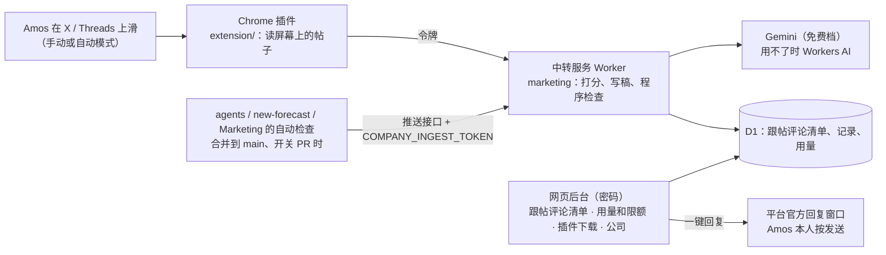

# 项目地图：Marketing
- 用途：**新加入的人或大模型先读这一份**，10 分钟了解项目现在是什么样、代码在哪里、有哪些不能破坏的约定。要查具体的文件、接口、表、变量、历史问题，看《[项目索引](项目索引.md)》。
- 只写**当前状态**；和别的文档不一致时，以本文件和代码为准。
- 版本：v1.3（2026-11-01，运营仪表盘 PR 6：本仓库用 `.github/workflows/company.yml` + `scripts/company-report.mjs` 上报自己的【要你决定】PR 和 CI）；v1.2（2026-11-01，后台加第四页"公司"（运营仪表盘）和推送接口；对应代码：副驾驶插件 0.3.5 + 中转服务和网页后台）；v1.1（2026-10-30，后台加"插件下载"）
- 维护：研发整合，各角色写自己的部分（C53）。**每次功能迭代，在同一个 PR 里更新本文件和《项目索引》**；`scripts/check-project-index.mjs` 在 CI 里检查（C54）。
- **内部文档**：需求池、技术方案、状态清单、复盘在 agents 仓库（`dollar3651314/agents` 的 `产品/marketing/`、`营销团队/副驾驶/`，C119），本仓库只放代码和这两份地图、索引。
- 变更历史：v1.0（2026-10-30）首次创建；正式版绑定 `marketing.quickcome.online`，测试版继续用 workers.dev（Amos 选 B）；Worker 和 D1 改名 marketing；仓库公开（只有代码，内部文档在 agents）；旧测试版（quickcome-copilot-staging）的数据搬进正式版，旧测试版转正（Amos："原来的测试环境，直接给我改造成marketing项目的生成环境吧"）；10-30 正式版上线（清单 22 条、记录 39 条逐表核对一致，Amos 确认"正式版没问题"），一次性搬数据脚本已删；staging、main 已开分支保护；测试版 marketing-staging 的密钥用的时候再填。Amos 2026-10-30："这个副驾驶+跟帖评论清单可以作为一个独立的系统使用"，K-1～K-4 都按建议（内部工具、跳过调研直接做 1.0、私有仓库、Worker 和 D1 起初沿用 `quickcome-copilot`，同日改名 `marketing` / `marketing-staging`（Amos："在cloudflare中测试项目的名字也要跟着改"）），项目名 Marketing；代码从 new-forecast staging `ea4482a` 的 `site/copilot/` 原样搬来

## 一图看懂


## 1. 这个项目做什么
营销团队的社媒副驾驶（agents C133、C136）：Amos 刷 X / Threads 时，插件读屏幕上的帖子，AI 打分；分数够的写好回复草稿（过程序检查），存进"跟帖评论清单"；Amos 在网页后台点"一键回复"打开官方回复窗口，自己按发送。现在推广的产品只有 Quick Come（forecast），规则写在 `rules/forecast.ts`；多产品管理在需求池（M-1）。

后台第四页"公司"（运营仪表盘，Amos 2026-11-01 确认技术方案 v0.3 和原型）：把 agents 的状态卡、交接记录、Amos 待办、项目版图、周报、岗位学习，以及三个仓库的【要你决定】PR 和 CI 放在一页，Amos 只读、可以点"我做了"。推送模型：各仓库的自动检查在合并到 main、开 / 关 PR 时解析好推过来（`POST /api/company/ingest`），Worker 不读 GitHub、没有定时任务（B-6：不要每天兜底）。

## 2. 代码怎么分层
- `extension/`：Chrome 插件（Manifest V3，只要 `sidePanel`、`storage` 权限）。`content.js` 在页面里读帖子、加标记、按指令滑动；`sidepanel.js` 管打分、写稿、存清单、自动模式、设置。
- `src/`：中转服务和网页后台（一个 Worker）。`index.ts` 路由和 `/v1/*`（插件用，令牌）；`queue.ts` 后台接口 `/api/*`（密码登录）；`admin-page.ts` 后台页面；`company.ts` 公司运营仪表盘的推送接口和读取接口；`ai.ts` / `gemini.ts` / `workers-ai.ts` 调 AI；`checks.ts` 程序检查；`usage.ts` 用量和上限。
- `rules/`：给 AI 的打分和写稿规则（每个产品一份）。
- `migrations/`：D1 表结构。

## 3. 环境
| 环境 | 分支 | Worker / D1 | 地址 |
|---|---|---|---|
| 测试版 | `staging` | `marketing-staging` | https://marketing-staging.jeff-zhaifei.workers.dev |
| 正式版 | `main` | `marketing` | https://marketing.quickcome.online （Amos 2026-10-30；workers.dev 地址先留作备用） |

开发分支 PR 到 `staging`（合并即部署测试版）；`staging` → `main` 要 Amos 说"合并"（部署正式版）。密钥在 Cloudflare 控制台填，测试版、正式版的值不同。

## 4. 关键流程在哪里
- 打分：插件 `sidepanel.js` → `POST /v1/score` → `src/index.ts` `score()` → `src/ai.ts`。
- 写稿和存清单：`saveToList()`（`sidepanel.js`）→ `/v1/draft`（程序检查 `src/checks.ts`）→ `/v1/queue` → `src/queue.ts` `saveToQueue()`。
- 自动模式：`sidepanel.js` `autoLoop()` 一步一步让 `content.js` 滑一屏；切分页停、读不到新帖暂停、存满 N 条停、到时间停。
- 后台：`src/admin-page.ts`（页面）+ `src/queue.ts` `adminApi()`（接口）。
- 本仓库自己的上报：推送到 main、PR 开 / 关 / 重开 / 改标题、main 的 CI（ci）跑完 → `.github/workflows/company.yml` → `scripts/company-report.mjs`（读本仓库 PR 和 ci.yml 的运行，source = `marketing`）→ `POST /api/company/ingest`；没填 Actions Secret `COMPANY_INGEST_TOKEN` 时打印"跳过"。
- 公司页：各仓库自动检查 → `POST /api/company/ingest`（`src/company.ts` `companyIngest()`，在后台密码判断之前处理）→ 表 `company_snapshot`；页面 `go('company')` → `GET /api/company`；"我做了" → `POST /api/company/done` → 表 `company_done`。
- 插件下载（Amos 2026-10-30）：部署时 `scripts/build-ext-zip.mjs` 把 `extension/` 打成 zip 放进服务；后台"插件下载"页登录后下载，所以后台给的插件和线上服务一定是同一个提交。

## 5. 不能破坏的约定
1. 插件只读屏幕上已显示的帖子、只在 Amos 打开开关时滑动；不点赞、不关注、不私信、不点开帖子、不代按发送；不做规避平台检测的处理（C133、C136）。
2. 自动模式的边界按 agents《营销团队手册》A8 第 7 条：每次最多 30 分钟（只能往下调）或存满 N 条；切分页、关分页或侧边栏就停；页面出现登录、验证、太频繁、出错立刻停。
3. 草稿要过程序检查才给 Amos 看：不能说的话（含下注说法）、提产品、链接、政治、字数、数字要有出处、原帖没有的结论（R-1、R-2）。
4. `COPILOT_TOKEN`、`GEMINI_API_KEY`、`COPILOT_PASSWORD` 没填时对应接口一律 404（默认关着）；密钥不进仓库、不经过 AI。
5. Workers AI 每天上限最多 9,500（免费额度 10,000），不产生费用（C117）。
6. 清单记录不自动删，只由 Amos 在后台删（D-4 选 B）。
7. 每个窗口的插件设置各自生效（0.3.3）；界面上的提示和实际行为一致（C140）。
8. 公司页（2026-11-01）：`COMPANY_INGEST_TOKEN` 没填时推送接口 404、页面显示"还没开通"；推送只依赖这个令牌（不要会话），只写公司的三张表；某块解析失败时保留上次成功的内容、页面显示"解析失败：原因"；**公司页脚本单独一个 `<script>`、整段 try/catch、只在打开这页时执行，旧三页的代码不动**；内容一律 `textContent` 插入；不加定时任务。
9. **格式即接口**：agents 的状态卡、交接记录、Amos 待办、周报的标题和列头由 agents 的解析脚本读，推过来的字段白名单在 `src/company.ts` 的 `SCHEMA`；改字段要两边同一批改。`scripts/company-report.mjs` 在 new-forecast 有一份内容相同的，改一边要同步另一边（对拍用例在 `test/company.test.ts`）。

## 6. 常用命令
```
npm ci
npm run typecheck
npm test                       # 单元测试（D1 用本地 SQLite，AI 用替身）
node scripts/e2e-ext.mjs       # 插件侧边栏浏览器测试（要先 npx playwright install chromium）
node scripts/e2e-admin.mjs     # 网页后台浏览器测试（本地 wrangler dev + 本地 D1；--shots <目录> 另存公司页截图）
node scripts/check-project-index.mjs
npm run dry-run                # 检查 wrangler 配置能不能打包
```
打包插件：部署后在后台"插件下载"页下载；本地用 `npm run build:ext`（生成 src/generated 文件夹里的 extension.ts，不进仓库）。

## 7. 排查从哪里开始
- 插件没反应：侧边栏"日志"页（可以下载全部）；X / Threads 页面要在装插件之后刷新。
- "AI 暂时都用不了"：提示里写了每个模型的原因；后台"用量和限额"页看次数、状态和重置时间。
- 后台登不进：同一 IP 15 分钟错 5 次会锁 15 分钟，提示统一是"登录失败，请稍后再试"。
- 健康检查：`/health` 的 `copilot`、`admin`、`company` 是 `ok` 还是 `not_configured`。
- 公司页"做得怎么样"里 Marketing 那行不对：看本仓库 Actions 里 `company` 的运行日志（`node scripts/company-report.mjs --dry-run` 可在本机看要发什么）。它只在推送 main 和 PR 事件时跑，合并后 CI 还在跑时报的是"运行中"，下一次事件才更新。
- 公司页某块是灰的：数据超过 7 天没推过来，看对应仓库的自动检查有没有跑、有没有红叉；某块"解析失败"：agents 的文件格式改了，按原因改文件或解析脚本。

## 8. 常见改动的检查清单
- 改插件：`extension/manifest.json` 版本加一（后台下载的文件名用这个版本号，不加就分不出新旧）；跑 `node scripts/e2e-ext.mjs`；按 agents《副驾驶状态清单》走一遍并截图（C127、C141）。
- 改表：新加 `migrations/000N_*.sql`，不改旧文件；索引第 4 节同步。
- 改给 AI 的规则：`rules/*.ts` 和 `src/checks.ts` 一起看；规则来源是 agents 简报和团队手册。
- 改自动模式的边界：先改 agents《营销团队手册》A8（规则文件，要 Amos 说"合并"）。

## 9. 冷启动问题清单
- 新环境要 Amos 在 Cloudflare 填三个密钥（公司页另要 `COMPANY_INGEST_TOKEN`，同一个值也填进三个仓库的 Actions Secrets；没填时公司页"还没开通"），GitHub 填 `CLOUDFLARE_API_TOKEN`、`CLOUDFLARE_ACCOUNT_ID`；没填时部署打印"跳过"。
- 第一次部署会按名字查 D1，没有就建，再执行全部迁移。
